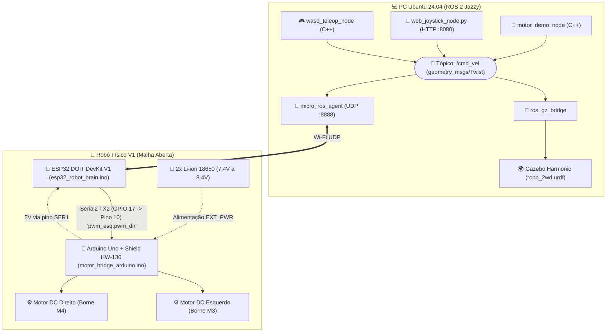
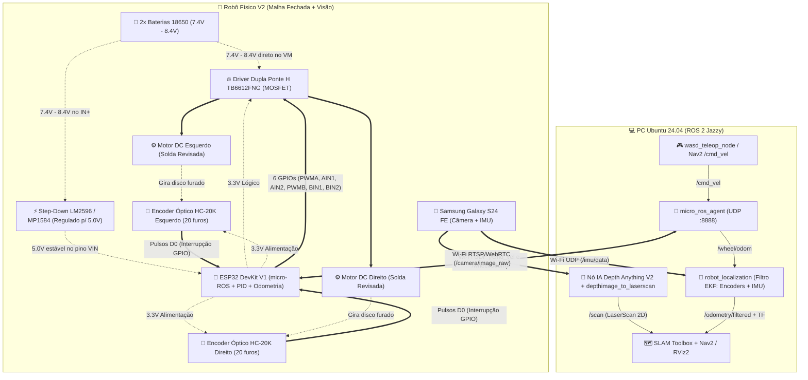
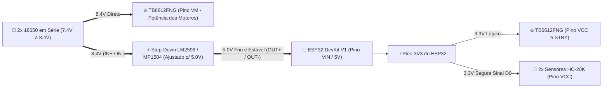
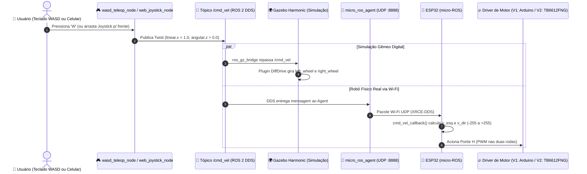
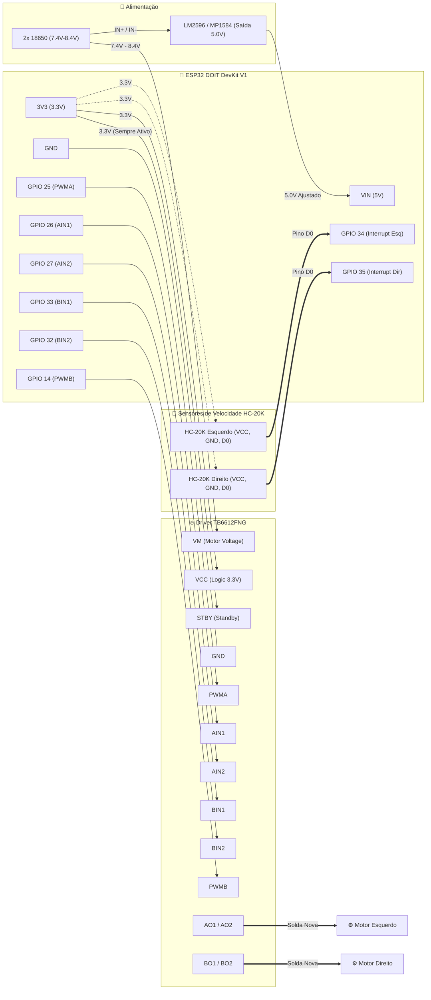
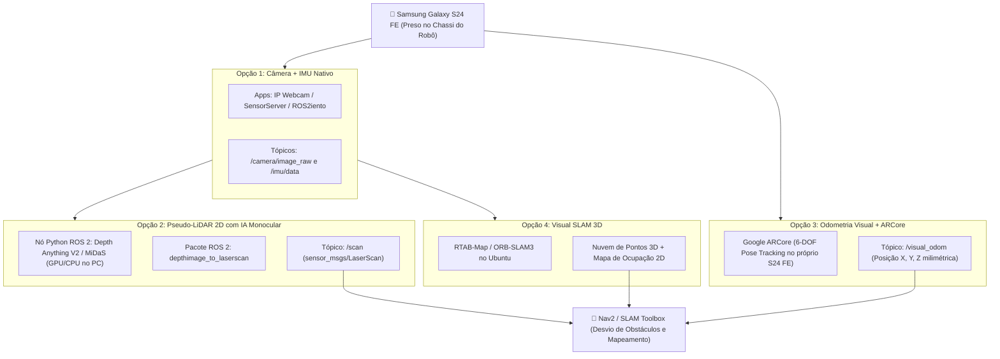
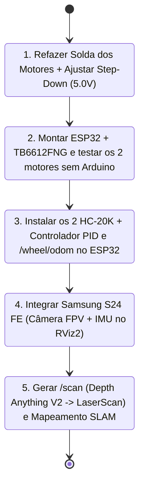

# 🤖 robo_2wd_control — Robô Móvel 2WD (Real + Simulação Gazebo + Roadmap V2)

Documentação técnica completa do pacote **`robo_2wd_control`** para controle de um **Robô Móvel de Tração Diferencial (2WD)** no **ROS 2 Jazzy** (Ubuntu 24.04), cobrindo:
1. **Arquitetura Atual (V1):** Robô físico sem fio com **ESP32 (micro-ROS)** + **Arduino Uno & Shield HW-130** + **Gêmeo Digital no Gazebo Harmonic** + Controles **WASD** e **Web Joystick Mobile**.
2. **Catálogo de Peças e Função de Cada Componente Físico:** Explicação detalhada do papel elétrico e mecânico de cada peça (atuais e novas).
3. **Análise do Código-Fonte:** Explicação módulo a módulo de todos os arquivos C++, Python, URDF, Launch e Firmwares (`.ino`).
4. **Arquitetura Upgrade (V2 — Em Construção):** Substituição do Arduino + HW-130 por **ESP32 Standalone + Ponte H TB6612FNG + Step-Down LM2596/MP1584 + 2x Encoders Ópticos HC-20K** (Malha Fechada PID + Odometria Real).
5. **Integração com Smartphone (Samsung Galaxy S24 FE):** Múltiplas arquiteturas para usar o S24 FE como pacote de sensores de alta performance (Câmera, IMU 6-DOF, Pseudo-LiDAR com IA Monocular e Visual SLAM).

---

## 🧭 Sumário

1. [Visão Geral da Arquitetura (V1 vs. V2)](#-1-visão-geral-da-arquitetura-v1-vs-v2)
2. [Guia Completo de Hardware: Para que serve cada peça?](#-2-guia-completo-de-hardware-para-que-serve-cada-peça)
3. [Por que usar o LM2596 ou MP1584 na Versão 2?](#-3-por-que-usar-o-lm2596-ou-mp1584-na-versão-2)
4. [Documentação do Código-Fonte e Estrutura do Pacote](#-4-documentação-do-código-fonte-e-estrutura-do-pacote)
5. [Ligações Físicas: Versão 1 (Atual) vs. Versão 2 (Novo Hardware)](#-5-ligações-físicas-versão-1-atual-vs-versão-2-novo-hardware)
6. [Samsung Galaxy S24 FE como Central de Sensores (Câmera, IMU e LiDAR)](#-6-samsung-galaxy-s24-fe-como-central-de-sensores-câmera-imu-e-lidar)
7. [Próximos Passos (Roadmap de Retomada)](#-7-próximos-passos-roadmap-de-retomada)
8. [Comandos Rápidos (Build e Execução)](#-8-comandos-rápidos-build-e-execução)

---

## 🏗️ 1. Visão Geral da Arquitetura (V1 vs. V2)

### 1.1 Arquitetura Atual (V1 — Híbrida ESP32 + Arduino Uno)

Na **Versão 1**, o processamento é dividido em dois microcontroladores: o **ESP32** atua como "Cérebro" (conectado ao ROS 2 via Wi-Fi UDP e calculando a cinemática diferencial) e o **Arduino Uno + Shield HW-130** atua como "Músculo" (recebendo o PWM via cabo serial no pino 10 e acionando os motores em malha aberta).



---

### 1.2 Nova Arquitetura (V2 — ESP32 Standalone + TB6612FNG + Encoders HC-20K + S24 FE)

Na **Versão 2**, eliminamos o Arduino Uno e o Shield HW-130. O **ESP32 controla diretamente a ponte H TB6612FNG**, lê os **2 sensores ópticos de velocidade HC-20K** via interrupções de hardware para fechar a malha de velocidade (PID) e publicar odometria real (`/wheel/odom`), enquanto o **Samsung Galaxy S24 FE** entra como sensor avançado de visão, IMU e profundidade/LaserScan.



---

## 🧩 2. Guia Completo de Hardware: Para que serve cada peça?

Abaixo está o inventário completo do projeto, explicando a função física, elétrica e de controle de cada componente.

### 2.1 Estrutura Mecânica e Atuação (Mantidos na V1 e V2)

| Peça | Quantidade | Para que serve fisicamente? |
| :--- | :---: | :--- |
| **Chassi Acrílico `ZK-2WD`** | 1 kit | Estrutura física principal ($20\text{ cm} \times 14\text{ cm}$) onde todas as placas, motores, suporte de baterias e sensores são parafusados. Possui furações específicas para fixar os sensores ópticos de velocidade ao lado dos discos de encoder. |
| **Motores DC Amarelos (TT) com Redução (1:48)** | 2 un. | Convertem energia elétrica em rotação mecânica. A caixa de engrenagens interna reduz a velocidade do motor DC puro e multiplica o **torque** (força) para conseguir empurrar o peso do robô. Possuem eixo duplo: o lado externo recebe a roda e o lado interno recebe o disco furado do encoder. |
| **Rodas de Borracha ($66\text{ mm}$)** | 2 un. | Acopladas aos motores esquerdo e direito (separadas por $17\text{ cm}$). Proporcionam tração diferencial: se giram juntas na mesma direção, o robô anda reto; se giram em sentidos opostos, o robô gira no próprio eixo. |
| **Roda Boba Frontal (*Caster Wheel*)** | 1 un. | Terceiro ponto de apoio livre (gira $360^\circ$ sem motor). Garante o equilíbrio estático do chassi sem oferecer resistência lateral às curvas comandadas pelas duas rodas traseiras. |
| **Suporte + 2x Baterias Li-ion `18650` ($3.7\text{ V}$)** | 2 células | Fonte de energia primária do robô. Ligadas **em série**, somam suas tensões: fornecem **$7.4\text{ V}$ nominais** (chegando a **$8.4\text{ V}$ quando $100\%$ carregadas**). Possuem alta capacidade de descarga de corrente, essencial para os picos de partida dos motores DC. |

---

### 2.2 Eletrônica da Versão 1 (Sendo Aposentada no Upgrade)

| Peça (V1) | Status | Função que cumpria e por que será substituída |
| :--- | :---: | :--- |
| **Arduino Uno R3** | 🔄 Substituído | Atuava como intermediário serial (`Pino 10`) apenas porque o Shield HW-130 tinha formato físico de encaixe do Arduino Uno. Ocupava muito espaço e adicionava latência serial de `9600` baud. |
| **Motor Shield HW-130 (Chip L293D)** | 🔄 Substituído | Ponte H antiga baseada em transistores bipolares (BJT). Desperdiça entre **$1.5\text{ V}$ e $2.0\text{ V}$** da bateria em forma de calor, reduzindo a força dos motores. |

---

### 2.3 Eletrônica da Versão 2 (Novas Peças + ESP32)

| Peça (V2) | Quantidade | Para que serve fisicamente no novo projeto? |
| :--- | :---: | :--- |
| **ESP32 DOIT DevKit V1** | 1 un. | **Cérebro único do robô.** Microcontrolador dual-core de $240\text{ MHz}$ com Wi-Fi integrado. Roda o nó **micro-ROS**, recebe `/cmd_vel`, lê os pulsos dos sensores `HC-20K` via interrupção de hardware, calcula o controle **PID** de velocidade de cada roda e gera os sinais **PWM** diretamente para o driver `TB6612FNG`. |
| **Driver Dupla Ponte H `TB6612FNG`** | 1 un. | **Novo músculo dos motores.** Substitui o Arduino + Shield HW-130. É uma ponte H dupla moderna baseada em **MOSFETs**: controla o sentido de giro (Frente/Ré/Freio) e a velocidade (via PWM) de 2 motores DC independentes. Sua queda de tensão é mínima ($\sim 0.2\text{ V}$), entregando quase $100\%$ da tensão da bateria aos motores sem esquentar, além de aceitar sinais lógicos de **$3.3\text{ V}$** diretamente do ESP32. |
| **Módulos de Medição de Velocidade `HC-20K` + Discos de 20 Furos** | 2 pares | **Encoders Ópticos Incrementais.** Cada módulo tem um emissor infravermelho e um fototransistor separados por uma fenda (comparador `LM393`). Quando o disco de 20 furos gira junto com o eixo do motor, ele interrompe o feixe de luz 20 vezes por volta, gerando uma onda quadrada digital no pino `D0`. Serve para o ESP32 medir a **velocidade real ($\text{RPM}$ e $\text{m/s}$)** e a **distância percorrida** por cada roda. |
| **Regulador Step-Down `LM2596` ou `MP1584`** | 1 un. | **Conversor DC-DC Abaixador de Tensão (Buck Converter).** Recebe os $7.4\text{ V}\text{–}8.4\text{ V}$ das baterias 18650 e reduz com alta eficiência ($\sim 92\%$) para **$5.0\text{ V}$ estabilizados** para alimentar o pino `VIN` do ESP32 com segurança (veja a seção 3 abaixo). |
| **Estanho de Solda** | 1 rolo | **Reconexão elétrica de baixa resistência nos motores DC e pinos do TB6612FNG.** Uma solda fria ou oxidada nos terminais de cobre do motor DC cria uma resistência parasita em série ($R_{\text{parasita}}$), causando queda de tensão ($V = R \cdot I$) quando o motor puxa corrente — motivo pelo qual um motor ficava mais fraco que o outro. |
| **Samsung Galaxy S24 FE** | 1 un. | **Suíte de Sensores de Alta Performance.** Fixado ao chassi, fornece câmera de alta resolução com estabilização, unidade inercial (IMU: acelerômetro + giroscópio de alta taxa) e processamento/streaming via Wi-Fi para gerar mapas de profundidade (Pseudo-LiDAR `/scan`) e Odometria Visual no ROS 2. |

---

## ⚡ 3. Por que usar o `LM2596` ou `MP1584` na Versão 2?

> [!WARNING]
> **Por que não ligar as 2 baterias 18650 ($8.4\text{ V}$) direto no pino `VIN` do ESP32?**
> Na placa ESP32 DevKit V1, o pino `VIN` passa por um regulador linear pequeno chamado **AMS1117-3.3**. Regulador linear funciona dissipando o excesso de tensão em forma de **calor puro**:
> $$P_{\text{calor}} = (V_{\text{entrada}} - 3.3\text{ V}) \times I_{\text{ESP32}}$$
> Como o ESP32 com Wi-Fi ligado consome picos de $250\text{ mA}$ a $400\text{ mA}$, ligar $8.4\text{ V}$ direto no `VIN` faz o pequeno chip AMS1117 dissipar até $2\text{ Watts}$ de calor, fazendo o ESP32 reiniciar sozinho por proteção térmica ou queimar o regulador.

Na **Versão 1**, o Arduino Uno + Shield HW-130 fazia esse papel no meio do caminho. Ao retirar o Arduino na **Versão 2**, o módulo **`LM2596`** (ou o mini **`MP1584`**) entra exatamente para resolver isso:



> [!IMPORTANT]
> **Dica de Ouro quando o seu `LM2596` ou `MP1584` chegar:**
> **Antes** de conectar o ESP32 na saída `OUT+` e `OUT-` do módulo Step-Down, ligue apenas a bateria na entrada (`IN+` e `IN-`), meça a saída com um multímetro (ou voltímetro) e gire o pequeno parafuso dourado (trimpot) até o visor marcar exatamente **`5.0V`**. Só depois conecte no `VIN` e `GND` do ESP32!

---

## 💻 4. Documentação do Código-Fonte e Estrutura do Pacote

### 4.1 Mapa dos Arquivos do Repositório

```text
robo_2wd_control/
├── arduino/
│   ├── esp32_robot_brain/
│   │   └── esp32_robot_brain.ino       ← Firmware principal do ESP32 (Wi-Fi + micro-ROS + Cinemática)
│   ├── motor_bridge_arduino/
│   │   └── motor_bridge_arduino.ino    ← Firmware V1 do Arduino Uno + Shield HW-130 (SoftwareSerial + AFMotor)
│   └── esp32_microros_hello/
│       └── esp32_microros_hello.ino    ← Firmware de diagnóstico / teste de conectividade micro-ROS UDP
├── launch/
│   ├── sim_gazebo.launch.py            ← Inicializa Gazebo Harmonic + robot_state_publisher + ros_gz_bridge
│   └── motor_bridge.launch.py          ← Inicializa a ponte serial USB direta (modo legado com cabo)
├── src/
│   ├── wasd_teleop_node.cpp            ← Controle de teclado estilo videogame em C++ (20 Hz + auto-stop)
│   ├── web_joystick_node.py            ← Servidor Web + Joystick Touch Mobile em Python (porta 8080)
│   ├── motor_demo_node.cpp             ← Nó autônomo de demonstração (curva senoidal frente/ré)
│   └── motor_bridge_node.cpp           ← Nó C++ POSIX (termios.h) para comunicação USB Serial direta
├── urdf/
│   └── robo_2wd.urdf                   ← Modelo 3D, inércia, colisão e plugin DiffDrive do Gazebo Harmonic
├── CMakeLists.txt                      ← Regras de compilação ament_cmake (C++ e instalação Python/URDF/Launch)
├── package.xml                         ← Manifesto ROS 2 e dependências (rclcpp, std_msgs, geometry_msgs)
└── README.md                           ← Esta documentação completa
```

---

### 4.2 Fluxo de Dados em Sequência (Como um comando move o robô)



---

### 4.3 Explicação Detalhada de Cada Código

#### 1. [`src/wasd_teleop_node.cpp`](file:///home/filipe/Desktop/ros2/my_workspace/src/projetos/robo_2wd_control/src/wasd_teleop_node.cpp) — Controle Estilo Videogame
* **O que faz:** Lê o teclado diretamente do terminal Linux em modo *raw* (`termios.h`, sem precisar apertar `Enter`) a uma taxa de **20 Hz ($50\text{ ms}$)** e publica mensagens `geometry_msgs/msg/Twist` no tópico `/cmd_vel`.
* **Como resolve o problema de soltar a tecla no Linux:** Quando você segura uma tecla no Ubuntu, o sistema operacional demora cerca de $500\text{ ms}$ antes de começar a repetir o caractere. O [`WasdTeleopNode::loop_callback`](file:///home/filipe/Desktop/ros2/my_workspace/src/projetos/robo_2wd_control/src/wasd_teleop_node.cpp#L88-L116) mantém o comando ativo por uma janela de $800\text{ ms}$ e, assim que você solta a tecla, envia `linear.x = 0.0, angular.z = 0.0` automaticamente para frear o robô.
* **Diagnóstico individual:** As teclas `1` e `2` enviam combinações de velocidade linear e angular (`linear = 0.5 * power`, `angular = ±0.5 * power`) que fazem a cinemática diferencial zerar uma das rodas e girar apenas a outra — perfeito para testar solda e fiação de cada motor separadamente.

#### 2. [`src/web_joystick_node.py`](file:///home/filipe/Desktop/ros2/my_workspace/src/projetos/robo_2wd_control/src/web_joystick_node.py) — Joystick Touch Pelo Celular (Anti-Lag)
* **O que faz:** Sobe simultaneamente um servidor HTTP multithread na porta `8080` e um nó ROS 2 (`WebJoystickNode`). Ao abrir `http://<IP_DO_PC>:8080` no navegador do celular, exibe uma interface web com um joystick analógico virtual.
* **Mecanismos de segurança e anti-lag:**
  - Controle de número de sequência (`seq`) para descartar pacotes Wi-Fi antigos que cheguem fora de ordem.
  - Limite de envio a $8\text{ Hz}$ ($125\text{ ms}$) para nunca saturar buffers seriais.
  - Parada automática imediata (`stopNow()`) se o usuário soltar o dedo da tela, bloquear o celular ou trocar de aba (`visibilitychange` / `blur`), além de um *watchdog* de $400\text{ ms}$ no servidor ROS 2.

#### 3. [`arduino/esp32_robot_brain/esp32_robot_brain.ino`](file:///home/filipe/Desktop/ros2/my_workspace/src/projetos/robo_2wd_control/arduino/esp32_robot_brain/esp32_robot_brain.ino) — Cérebro micro-ROS no ESP32
* **O que faz:** Conecta o ESP32 ao Wi-Fi e registra o nó `esp32_robot_brain` no `micro_ros_agent` via UDP na porta `8888`.
* **Cinemática Diferencial e Compensação de Zona Morta:**
  - Na função [`cmd_vel_callback`](file:///home/filipe/Desktop/ros2/my_workspace/src/projetos/robo_2wd_control/arduino/esp32_robot_brain/esp32_robot_brain.ino#L64-L91), converte `linear.x` e `angular.z` em porcentagens para cada roda:
    $$\text{left\_pct} = (\text{linear.x} - \text{angular.z}) \times 100$$
    $$\text{right\_pct} = (\text{linear.x} + \text{angular.z}) \times 100$$
  - Na função [`percentToPWM`](file:///home/filipe/Desktop/ros2/my_workspace/src/projetos/robo_2wd_control/arduino/esp32_robot_brain/esp32_robot_brain.ino#L56-L60), mapeia `1%..100%` para a faixa de PWM `130..255`, vencendo a zona morta de atrito estático da caixa de redução dos motores amarelos.

#### 4. [`urdf/robo_2wd.urdf`](file:///home/filipe/Desktop/ros2/my_workspace/src/projetos/robo_2wd_control/urdf/robo_2wd.urdf) e [`launch/sim_gazebo.launch.py`](file:///home/filipe/Desktop/ros2/my_workspace/src/projetos/robo_2wd_control/launch/sim_gazebo.launch.py) — Gêmeo Digital 3D
* **Modelagem Física Realista:** Define `base_footprint` $\rightarrow$ `base_link` (chassi $20 \times 14 \times 1.5\text{ cm}$, massa $500\text{ g}$) $\rightarrow$ `left_wheel` e `right_wheel` (juntas `continuous`, raio $3.3\text{ cm}$, separadas por $17\text{ cm}$, atrito $\mu = 1.0$) e `caster_wheel` (esfera frontal com atrito quase zero $\mu = 0.001$ para deslizar livremente).
* **Plugins Gazebo Harmonic:** Usa `gz::sim::systems::DiffDrive` escutando `/cmd_vel` e publicando `/odom` e `/tf`, além de `JointStatePublisher` para animar as rodas no RViz2.
* **Launch File:** O [`sim_gazebo.launch.py`](file:///home/filipe/Desktop/ros2/my_workspace/src/projetos/robo_2wd_control/launch/sim_gazebo.launch.py) sobe o `robot_state_publisher`, abre o Gazebo com `empty.sdf`, faz o spawn do robô e cria a `ros_gz_bridge` bidirecional.

#### 5. Nós de Apoio e Legado
* [`src/motor_demo_node.cpp`](file:///home/filipe/Desktop/ros2/my_workspace/src/projetos/robo_2wd_control/src/motor_demo_node.cpp): Máquina de estados de 6 fases que publica ondas senoidais suaves (`std::sin` / `std::cos`) em `/cmd_vel` para testes autônomos de rampa de aceleração e frenagem.
* [`src/motor_bridge_node.cpp`](file:///home/filipe/Desktop/ros2/my_workspace/src/projetos/robo_2wd_control/src/motor_bridge_node.cpp) e [`launch/motor_bridge.launch.py`](file:///home/filipe/Desktop/ros2/my_workspace/src/projetos/robo_2wd_control/launch/motor_bridge.launch.py): Implementação didática de comunicação serial USB via API POSIX (`open`, `tcgetattr`, `cfmakeraw`, `write`) usada antes da migração para Wi-Fi com micro-ROS.
* [`arduino/motor_bridge_arduino/motor_bridge_arduino.ino`](file:///home/filipe/Desktop/ros2/my_workspace/src/projetos/robo_2wd_control/arduino/motor_bridge_arduino/motor_bridge_arduino.ino): Firmware V1 do Arduino Uno que lê `SoftwareSerial` no pino 10, aciona os motores `M3` e `M4` e aplica um *failsafe* de $2000\text{ ms}$.

---

## 🔌 5. Ligações Físicas: Versão 1 (Atual) vs. Versão 2 (Novo Hardware)

### 5.1 Ligações da Versão 1 (ESP32 + Arduino Uno + Shield HW-130)

* **ESP32 $\leftrightarrow$ Shield HW-130 (Conector `SER1`):**
  - `VIN` (ESP32) $\leftrightarrow$ Pino `+` (`5V`) do `SER1`
  - `GND` (ESP32) $\leftrightarrow$ Pino `-` (`GND`) do `SER1`
  - `TX2 / GPIO 17` (ESP32) $\leftrightarrow$ Pino `S` (**Pino 10** do Arduino)
* **Motores e Bateria no Shield HW-130:**
  - Motor Esquerdo $\rightarrow$ Borne `M3` | Motor Direito $\rightarrow$ Borne `M4`
  - Baterias 18650 ($7.4\text{ V}\text{–}8.4\text{ V}$) $\rightarrow$ Borne `EXT_PWR` (`+M` e `GND`) com jumper `PWR` fechado.

---

### 5.2 Esquema Completo de Pinagem da Versão 2 (ESP32 + TB6612FNG + 2x HC-20K + Step-Down)

Na **Versão 2**, todos os componentes são ligados diretamente ao **ESP32 DOIT DevKit V1**. Escolhemos apenas GPIOs seguros do ESP32 (evitando pinos de boot delicados e deixando a USB livre):



#### Tabela de Pinagem Definitiva (V2)

| Componente | Pino no Componente | Pino no ESP32 / Fonte | Função |
| :--- | :--- | :--- | :--- |
| **Step-Down (`LM2596`/`MP1584`)** | `IN+` e `IN-` | `+` e `-` das Baterias 18650 | Recebe $7.4\text{ V}$ a $8.4\text{ V}$ da bateria |
| **Step-Down (`LM2596`/`MP1584`)** | `OUT+` e `OUT-` | `VIN` e `GND` do ESP32 | Entrega **$5.0\text{ V}$ regulados** para o ESP32 |
| **Driver `TB6612FNG`** | `VM` | `+` das Baterias 18650 ($7.4\text{ V}\text{–}8.4\text{ V}$) | Energia direta de força para os 2 motores DC |
| **Driver `TB6612FNG`** | `VCC` | Pino `3V3` do ESP32 | Alimentação lógica interna do chip ($3.3\text{ V}$) |
| **Driver `TB6612FNG`** | `STBY` | Pino `3V3` do ESP32 | Habilita a ponte H (precisa estar em nível alto `3.3V`) |
| **Driver `TB6612FNG`** | `GND` | `GND` comum (Bateria + ESP32) | Terra unificado de todo o circuito |
| **Driver `TB6612FNG` (Motor Esq)** | `PWMA` | `GPIO 25` | Controle de velocidade (PWM) da Roda Esquerda |
| **Driver `TB6612FNG` (Motor Esq)** | `AIN1` / `AIN2` | `GPIO 26` / `GPIO 27` | Sentido de giro (Frente / Ré / Freio) da Roda Esquerda |
| **Driver `TB6612FNG` (Motor Esq)** | `AO1` / `AO2` | Fios do Motor DC Esquerdo | Saída de potência para o Motor Esquerdo |
| **Driver `TB6612FNG` (Motor Dir)** | `PWMB` | `GPIO 14` | Controle de velocidade (PWM) da Roda Direita |
| **Driver `TB6612FNG` (Motor Dir)** | `BIN1` / `BIN2` | `GPIO 33` / `GPIO 32` | Sentido de giro (Frente / Ré / Freio) da Roda Direita |
| **Driver `TB6612FNG` (Motor Dir)** | `BO1` / `BO2` | Fios do Motor DC Direito | Saída de potência para o Motor Direito |
| **Encoder `HC-20K` Esquerdo** | `VCC` / `GND` / `D0` | `3V3` / `GND` / `GPIO 34` | Contagem de pulsos por interrupção da Roda Esquerda |
| **Encoder `HC-20K` Direito** | `VCC` / `GND` / `D0` | `3V3` / `GND` / `GPIO 35` | Contagem de pulsos por interrupção da Roda Direita |

> [!TIP]
> **Por que usar os `GPIO 34` e `GPIO 35` para os sensores `HC-20K`?**
> No ESP32, os pinos `34` e `35` são *Input-Only* dedicados e livres de interferência no boot, perfeitos para receber interrupções rápidas (`attachInterrupt(digitalPinToInterrupt(34), isr_left, RISING)`). E alimentando os módulos `HC-20K` no pino `3V3`, o sinal `D0` nunca ultrapassa $3.3\text{ V}$, protegendo o ESP32 sem precisar de divisor resistivo!

---

## 📱 6. Samsung Galaxy S24 FE como Central de Sensores (Câmera, IMU e LiDAR)

O seu **Samsung Galaxy S24 FE** possui um processador Exynos 2400e potente, câmeras excelentes com estabilização óptica (OIS), suporte nativo ao **Google ARCore**, Wi-Fi 6E de baixíssima latência e sensores inerciais (acelerômetro, giroscópio e magnetômetro) muito superiores a módulos baratos como o MPU6050.

Sem o Arduino Uno ocupando o topo do chassi, você pode fixar um suporte de celular inclinado na frente do robô e usar o **S24 FE** em **4 níveis de integração com o ROS 2**:



### Detalhamento das 4 Opções para o seu S24 FE:

#### Opção 1: Streaming de Câmera + IMU para o ROS 2 (Mais simples para começar)
* **Como funciona:** Você instala no S24 FE o app gratuito **IP Webcam** (para vídeo MJPEG/RTSP de baixa latência) e/ou um app transmissor de sensores como **SensorServer** ou **Sensors2ROS** (que envia Acelerômetro + Giroscópio via WebSocket/UDP).
* **No ROS 2:** Um nó leve no seu pacote captura o stream e publica `/camera/image_raw` (`sensor_msgs/msg/Image`) e `/imu/data` (`sensor_msgs/msg/Imu`).
* **Vantagem:** Você dirige o robô pelo quarto vendo a câmera em primeira pessoa (FPV) dentro do **RViz2**, e usa o giroscópio do S24 FE junto com os encoders `HC-20K` para saber o ângulo exato de giro do robô!

#### Opção 2: Transformar a Câmera do S24 FE em um "LiDAR" (`/scan`) com IA Monocular
* **Como funciona:** Como celulares Android geralmente não têm LiDAR físico (exceto aparelhos com sensor ToF específico), usamos **Estimativa de Profundidade Monocular por IA** rodando no seu PC Ubuntu!
  1. O S24 FE envia a imagem da câmera via Wi-Fi para o Ubuntu.
  2. Um nó ROS 2 em Python roda o modelo **Depth Anything V2 (Small)** em tempo real e transforma a foto comum em uma **Imagem de Profundidade (`/camera/depth/image_raw`)**, onde cada pixel indica a distância até as paredes, móveis e obstáculos.
  3. O pacote oficial do ROS 2 **`depthimage_to_laserscan`** fatia uma linha horizontal dessa imagem de profundidade (na altura do robô) e publica um tópico **`/scan` (`sensor_msgs/msg/LaserScan`)** idêntico ao de um LiDAR 2D real!
* **Vantagem:** Você consegue rodar o **SLAM Toolbox** e o **Nav2** para mapear a casa e desviar de obstáculos usando apenas a câmera do seu S24 FE!

#### Opção 3: Odometria Visual-Inercial (VIO) via Google ARCore no S24 FE
* **Como funciona:** O Samsung Galaxy S24 FE tem suporte oficial e calibrado de fábrica para o **Google ARCore**. O próprio chip do S24 FE funde a câmera com o IMU interno para calcular o deslocamento 3D $(x, y, z, \text{roll}, \text{pitch}, \text{yaw})$ com precisão centimétrica sem derrapar (diferente das rodas, que podem patinar no piso liso).
* **No ROS 2:** Essa pose é enviada via Wi-Fi para o ROS 2 e combinada no pacote `robot_localization` (Filtro de Kalman Estendido — EKF) junto com os sensores `HC-20K`.

#### Opção 4: Visual SLAM Completo (ORB-SLAM3 ou RTAB-Map)
* **Como funciona:** O PC Ubuntu recebe `/camera/image_raw`, `/imu/data` (do S24 FE) e `/wheel/odom` (dos sensores `HC-20K` no ESP32) e constrói um mapa 3D colorido do ambiente enquanto localiza o robô.

---

## 🚀 7. Próximos Passos (Roadmap de Retomada)

Aqui está a sequência passo a passo recomendada para você executar assim que o `LM2596` / `MP1584` chegar:



### Checklist Prático de Cada Etapa:
- [ ] **Etapa 1 — Revisão Elétrica e Solda:**
  - Dessoldar os fios antigos dos 2 motores DC amarelos, limpar os terminais de cobre e refazer a solda com estanho novo.
  - Regular o `LM2596` / `MP1584` para cravar **$5.0\text{ V}$** na saída antes de ligar no ESP32.
- [ ] **Etapa 2 — Migração para ESP32 Standalone + `TB6612FNG`:**
  - Retirar o Arduino Uno e o Shield HW-130 do chassi.
  - Conectar o `TB6612FNG` nos GPIOs `25, 26, 27, 14, 32, 33` do ESP32.
  - Atualizar o [`esp32_robot_brain.ino`](file:///home/filipe/Desktop/ros2/my_workspace/src/projetos/robo_2wd_control/arduino/esp32_robot_brain/esp32_robot_brain.ino) para acionar os pinos PWM diretamente no ESP32 (com failsafe integrado no próprio ESP32).
- [ ] **Etapa 3 — Malha Fechada e Odometria com os 2x `HC-20K`:**
  - Encaixar os discos de 20 furos no eixo interno dos motores e parafusar os sensores `HC-20K` no chassi.
  - Ligar os pinos `D0` nos `GPIO 34` e `GPIO 35` do ESP32.
  - Adicionar contagem por interrupção, cálculo de velocidade real ($\text{rad/s}$ e $\text{m/s}$), **PID de velocidade** (para as duas rodas girarem exatamente iguais) e publicação do tópico de odometria pelo micro-ROS.
- [ ] **Etapa 4 — Integração do Samsung Galaxy S24 FE (Câmera + IMU):**
  - Prender o S24 FE na frente do chassi.
  - Criar o nó ROS 2 receptor de vídeo e IMU do S24 FE e adicionar o link da câmera/IMU no [`robo_2wd.urdf`](file:///home/filipe/Desktop/ros2/my_workspace/src/projetos/robo_2wd_control/urdf/robo_2wd.urdf).
- [ ] **Etapa 5 — Pseudo-LiDAR (`/scan`) e Navegação:**
  - Configurar o pipeline `Depth Anything V2` $\rightarrow$ `depthimage_to_laserscan` para publicar `/scan` a partir da câmera do S24 FE e visualizar as paredes e obstáculos em tempo real no RViz2.

---

## 🛠️ 8. Comandos Rápidos (Build e Execução)

### Compilar o Pacote no Workspace
```bash
cd ~/Desktop/ros2/my_workspace
source /opt/ros/jazzy/setup.bash
colcon build --packages-select robo_2wd_control
source install/local_setup.bash
```

### Rodar na Simulação 3D (Gazebo Harmonic)
```bash
# Terminal 1 — Abre o Gazebo com o carrinho 3D:
source /opt/ros/jazzy/setup.bash
source ~/Desktop/ros2/my_workspace/install/local_setup.bash
ros2 launch robo_2wd_control sim_gazebo.launch.py
```

### Rodar no Robô Físico Sem Fio (micro-ROS Agent)
```bash
# Terminal 1 — Inicia o Agente micro-ROS (Wi-Fi UDP porta 8888):
source /opt/ros/jazzy/setup.bash
source ~/Desktop/ros2/microros_ws/install/local_setup.bash
ros2 run micro_ros_agent micro_ros_agent udp4 --port 8888
```

### Opções para Dirigir o Robô (Funciona no Real e no Gazebo)
```bash
# Opção A — Controle pelo Teclado WASD estilo videogame:
source /opt/ros/jazzy/setup.bash
source ~/Desktop/ros2/my_workspace/install/local_setup.bash
ros2 run robo_2wd_control wasd_teleop_node

# Opção B — Joystick Touch pelo Navegador do Celular (porta 8080):
source /opt/ros/jazzy/setup.bash
source ~/Desktop/ros2/my_workspace/install/local_setup.bash
ros2 run robo_2wd_control web_joystick_node.py
```
